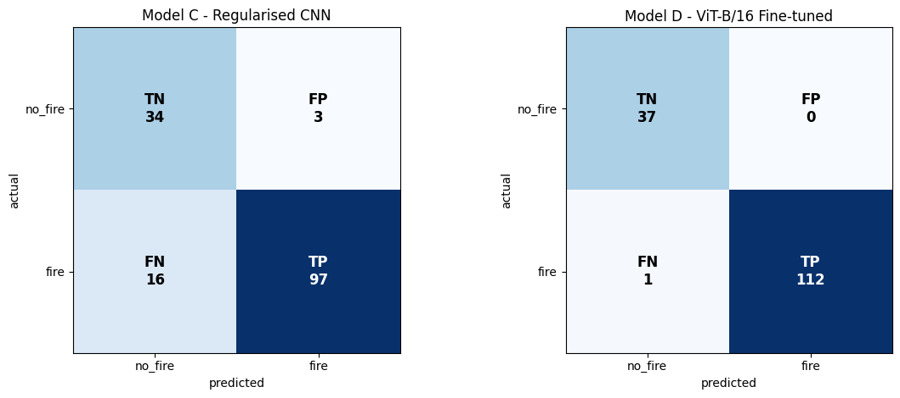
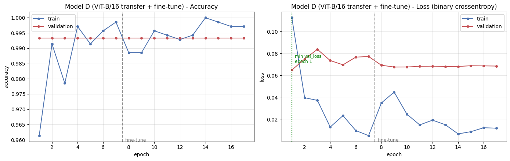
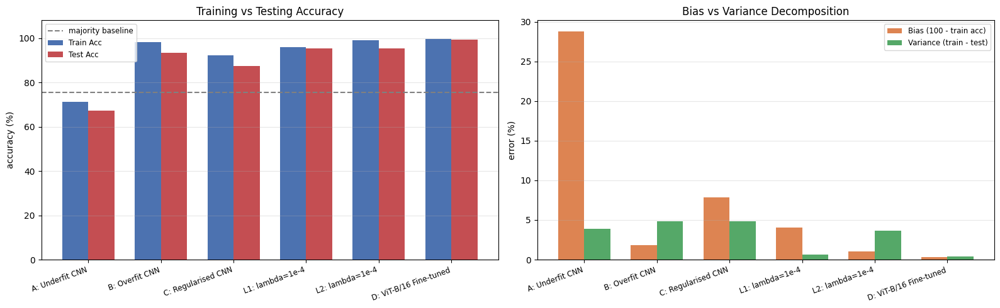
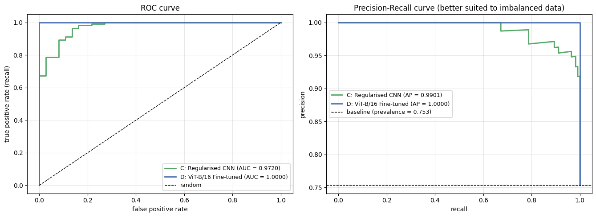

# Capstone: Wildfire Detection Using CNN

Capstone project, MUJ Data Science Training Program, Batch D. Hosted in this personal repository.

Single-image wildfire detection (fire vs no-fire) on the Kaggle FIRE dataset, comparing custom CNNs, ResNet50 and MobileNetV2 with a fine-tuned ViT-B/16, plus an SE-attention + focal-loss innovation.

## Team

| Name | Registration No. | GitHub | Role |
| --- | --- | --- | --- |
| Shaurya Gupta | 2430010320 | [@shauryagupta575](https://github.com/shauryagupta575) | Model development, documentation |
| [Teammate, if any] | [RegNo] | [@username](https://github.com/) | [Role] |
| Instructor | — | [@instructor-username](https://github.com/instructor-username) | Reviewer |

## Results

Test split: 150 images (113 fire, 37 no-fire). Full tables in [`results/`](results/).

| Model | Accuracy | Macro-F1 | Missed fires | False alarms |
| --- | --- | --- | --- | --- |
| **ViT-B/16 (fine-tuned)** | **99.33%** | **0.991** | **1** | **0** |
| ResNet50 (frozen) | 99.33% | 0.991 | 1 | 0 |
| MobileNetV2 (frozen) | 97.33% | 0.965 | 4 | 0 |
| CNN + SE attention | 92.67% | 0.897 | 3 | 8 |
| Regularised CNN | 87.33% | 0.846 | 16 | 3 |

### Screenshots

| Confusion matrices | Training curves (ViT-B/16) |
| --- | --- |
|  |  |

| Bias vs variance | ROC and PR curves |
| --- | --- |
|  |  |

All 21 figures are in [`results/screenshots/`](results/screenshots/).

## Deliverables

| Deliverable | Location |
| --- | --- |
| Source code | [`../code/`](../code/), [`../notebooks/`](../notebooks/) |
| Documentation | [`../assignments/`](../assignments/) (CO4, CO5, literature review) |
| Presentation | [`../presentations/Wildfire_Detection_CNN_Presentation.pptx`](../presentations/Wildfire_Detection_CNN_Presentation.pptx) |
| Screenshots | [`results/screenshots/`](results/screenshots/) |
| Results | [`results/`](results/) |
| Installation guide | [`INSTALLATION.md`](INSTALLATION.md) |
| Dataset instructions | [`data/README.md`](data/README.md) |
| Contribution workflow | [`CONTRIBUTING.md`](CONTRIBUTING.md) |

## Issues and pull requests

Work is tracked in this repository's [Issues](https://github.com/shauryagupta575/MUJ-DS-2430010320/issues). Issue and PR templates are in [`.github/`](../.github/); create the five starter issues with `bash capstone/scripts/create_issues.sh` (needs the GitHub CLI).

## My contributions

| Date | Contribution | Link |
| --- | --- | --- |
| [date] | [e.g. Built ViT-B/16 training pipeline] | [PR #] |
| [date] | [e.g. Wrote installation guide] | [PR #] |
